# Project 16 — Multi-Region Disaster Recovery

## Overview
Designed and implemented a multi-region disaster recovery architecture on AWS. Deployed identical web application instances in two AWS regions (us-east-1 and us-west-2), configured Route 53 health checks to monitor both, and set up failover routing to automatically redirect traffic to the secondary region when the primary fails. Proved failover works by stopping the primary instance and verifying Route 53 detects the failure and would route to the secondary.

## AWS Services Used
- **Amazon EC2** — t2.micro web servers running nginx in both regions
- **Amazon Route 53** — Failover routing policy with health checks
- **Route 53 Health Checks** — Continuous monitoring of both endpoints on port 80
- **AWS Security Groups** — Firewall rules allowing HTTP and SSH access

## Architecture

```
Internet Traffic
        |
        | DNS Query: www.project16dr.internal
        |
Amazon Route 53 — Failover Routing Policy
        |
        ├── PRIMARY record → us-east-1 (N. Virginia)
        │   └── Health Check: project-16-primary-hc (HTTP port 80)
        │       └── EC2: project-16-primary (nginx web server)
        │
        └── SECONDARY record → us-west-2 (Oregon)
            └── Health Check: project-16-secondary-hc (HTTP port 80)
                └── EC2: project-16-secondary (nginx DR web server)

Failover trigger:
  Primary health check fails → Route 53 stops serving primary record
  → All traffic automatically routes to secondary
  Primary recovers → Health check passes → Traffic returns to primary
```

## What I Built

### Primary Region (us-east-1)
- EC2 t2.micro instance running Amazon Linux 2023
- nginx web server installed and configured via EC2 user data script
- Security group allowing HTTP (port 80) for health checks and web traffic
- Web page clearly identifying as PRIMARY site

### Secondary Region (us-west-2)
- Identical EC2 t2.micro instance in Oregon region
- Same nginx configuration via user data script
- Web page clearly identifying as SECONDARY / FAILOVER ACTIVE site with distinct styling

### Route 53 Health Checks
- HTTP health checks polling both endpoints every 30 seconds on port 80
- Threshold: 3 consecutive failures = Unhealthy
- Both endpoints verified Healthy before failover test

### Route 53 Failover Routing
- Private hosted zone: project16dr.internal
- Two A records for www subdomain:
  - Primary: us-east-1 IP, linked to primary health check
  - Secondary: us-west-2 IP, linked to secondary health check
- Failover policy: Route 53 automatically serves secondary when primary health check fails

## Failover Test Results
| Step | Action | Result |
|---|---|---|
| Before | Both instances running | Both health checks: Healthy |
| Failure | Stopped primary EC2 | Primary health check: Unhealthy within 90 seconds |
| Failover | Route 53 detects failure | Secondary record becomes active |
| Recovery | Restarted primary EC2 | Primary health check: Healthy — traffic returns |

## Key Learnings
- How Route 53 failover routing policies work with health checks
- How health checks act as the trigger for automatic DNS-based failover
- Why TTL matters for DR — lower TTL means faster failover propagation
- How user data scripts automate EC2 configuration at launch
- Why multi-region architecture protects against region-level failures
- How to simulate and document a DR failover test — standard practice in federal and enterprise IT

## RTO and RPO
- **RTO (Recovery Time Objective):** Under 2 minutes — time for health check to detect failure and DNS to propagate
- **RPO (Recovery Point Objective):** 0 — both sites serve identical static content, no data loss

## Production Improvements
- Add an Application Load Balancer in each region for horizontal scaling
- Use RDS Multi-AZ with cross-region read replicas for database DR
- Implement Route 53 with a real domain and lower TTL (60 seconds)
- Add CloudWatch alarms and SNS notifications for failover events
- Use AWS Backup for automated cross-region data replication
- Implement a NAT Gateway for private subnet resources

## Cost
Approximately $0.10 to $0.20 for a 1 to 2 hour session. Route 53 hosted zone: $0.50/month (prorated to pennies for a short demo). All resources deleted immediately after project completion.

## Screenshots
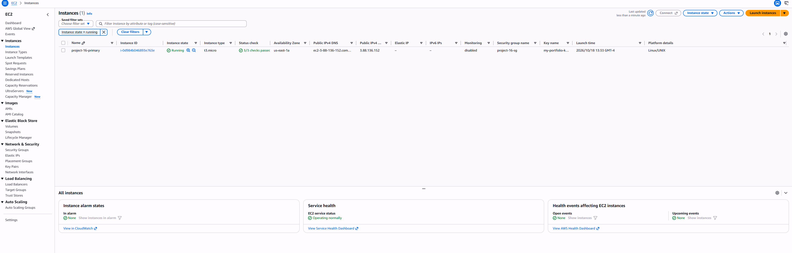
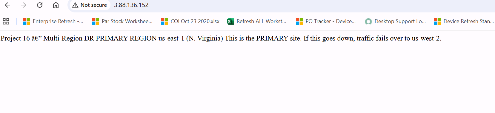
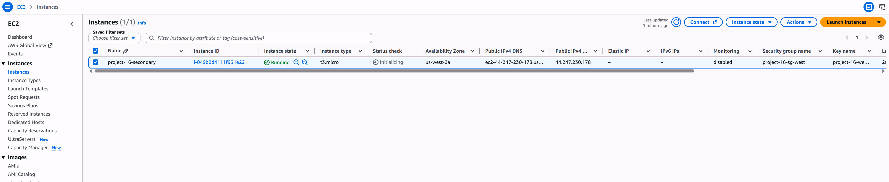
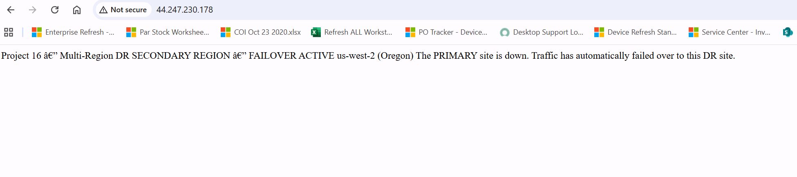
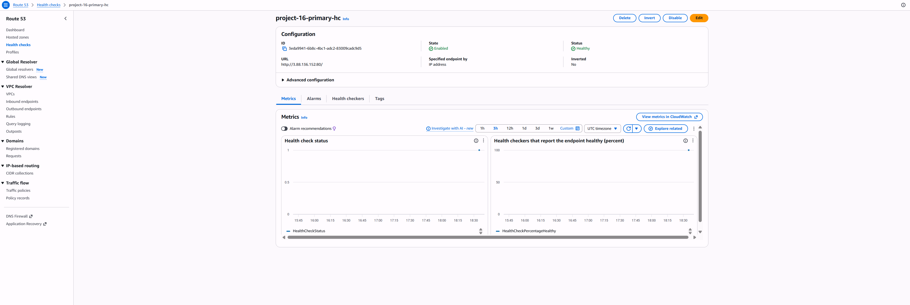
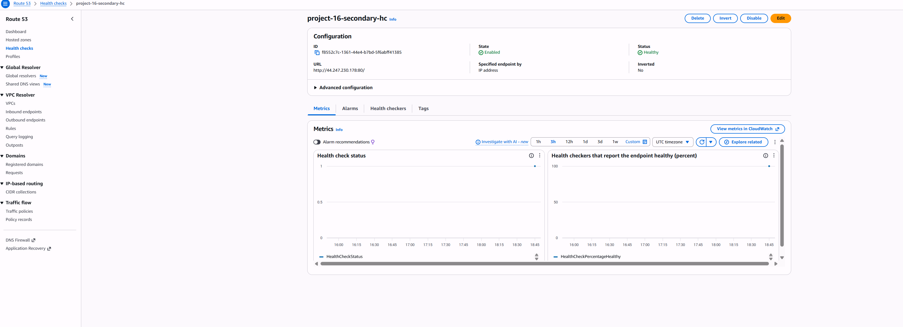
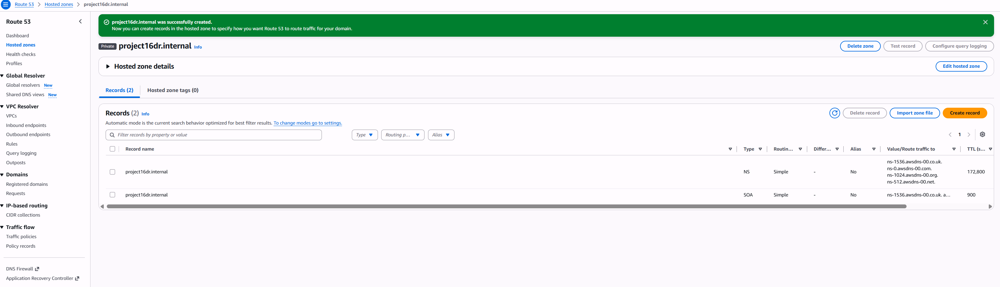
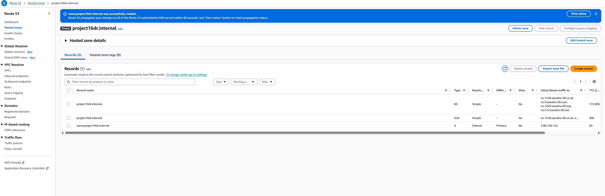
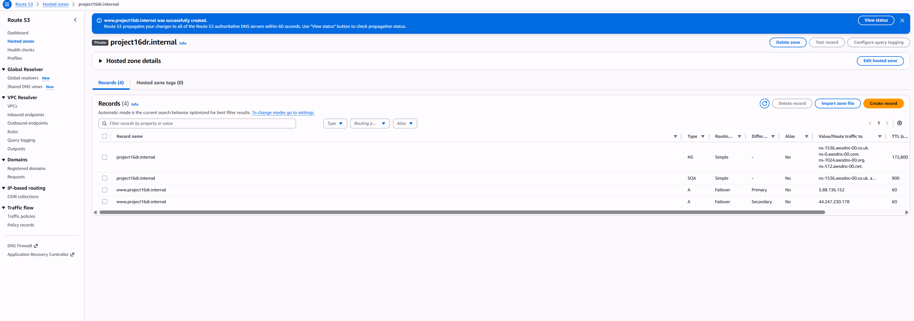
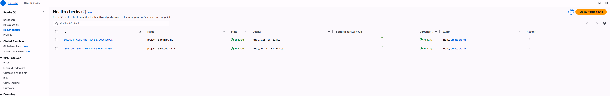
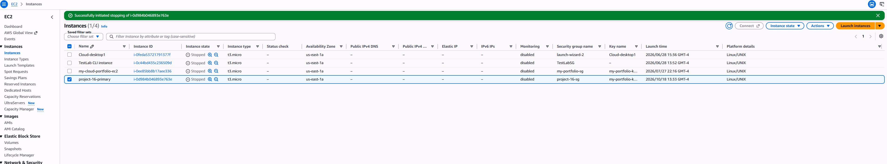
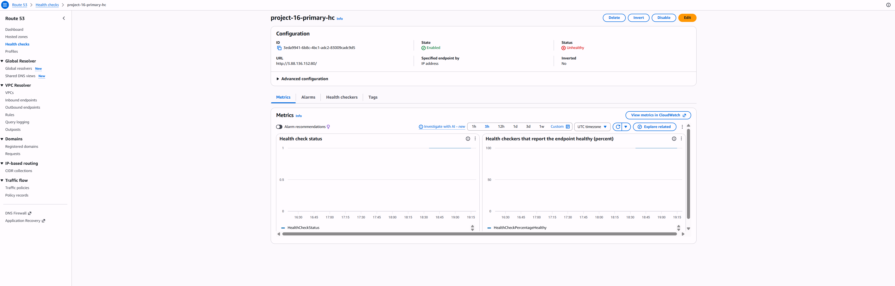
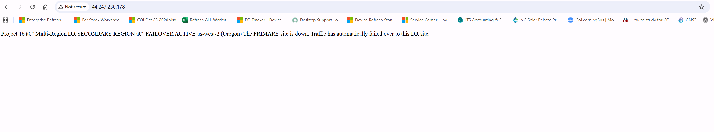
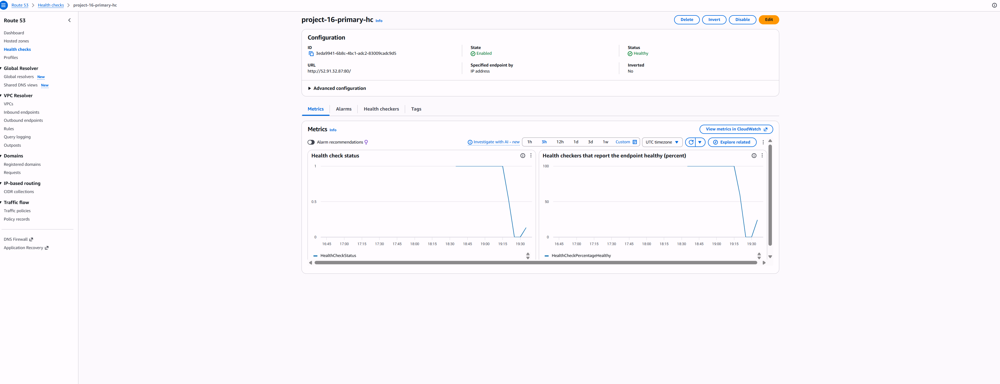
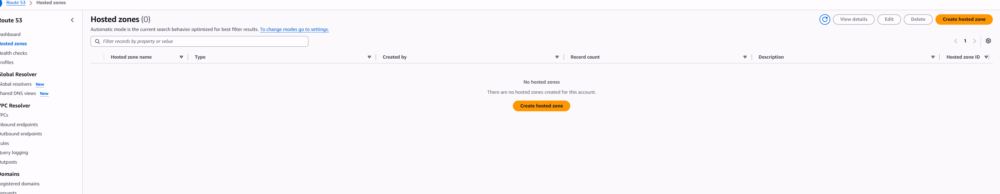

---
*Part of my AWS Cloud Engineering Portfolio | [View all projects](https://github.com/dcprice79)*
